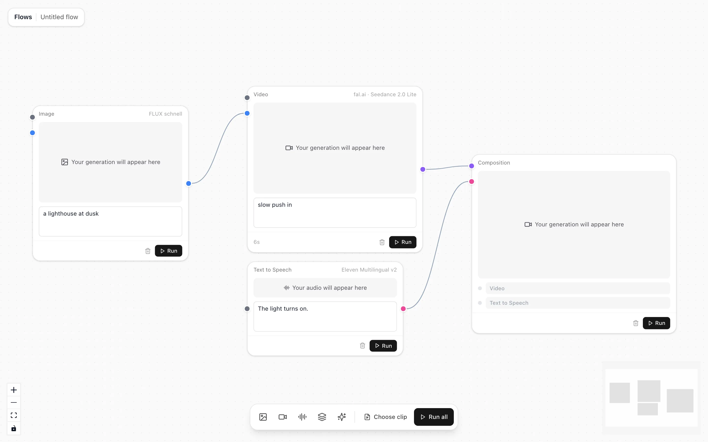

# Flow Builder

Node-based visual flow builder for AI media pipelines — built with **Next.js 16**, **React Flow**, and **Zustand**.



**Live:** https://flow-builder-navy.vercel.app

Inspired by Higgsfield Flows / ComfyUI: drag nodes for image / video / TTS / composition onto a canvas, wire them together with typed handles, and run the graph end-to-end. Concept Cluster nodes turn a loose prompt into groups of suggestions you can pin and wire on as text, and a dropped video clip is read into a starting graph.

## Stack

- Next.js 16 (App Router) + React 19 + Turbopack
- [React Flow](https://reactflow.dev) (`@xyflow/react`) — MIT
- Zustand for the open flow; flows are saved in the browser's IndexedDB (`idb-keyval`)
- Zod for file and LLM response schemas
- Vitest + Testing Library for tests
- Tailwind CSS v4
- Vercel AI SDK 7 and the AI Gateway for the LLM routes (Concept Cluster, clip analysis)
- Vercel Blob for media storage
- fal.ai for image/video, ElevenLabs for TTS

## Quick start

```bash
pnpm install
cp .env.local.example .env.local   # optional — works in stub mode without keys
pnpm dev
```

Open [http://localhost:3000](http://localhost:3000); it opens your newest flow, or creates one at `/flows/<id>`. `pnpm test` runs the Vitest suite and `pnpm typecheck` runs `tsc`. The toolbar at the bottom adds nodes; drag from a node's right handle to another node's matching-coloured left handle. Hit **Run** on any node, or **Run all** to execute the whole graph in topological order.

## Handle colours

| Type | Colour |
|---|---|
| `text` | grey |
| `image` | blue |
| `video` | purple |
| `audio` | pink |

Connections are only allowed between handles of the **same** type.

## Stub mode

If you don't set `FAL_KEY` / `ELEVENLABS_API_KEY`, the API routes return placeholder media URLs so you can exercise the full UI without provisioning anything. Add the keys to `.env.local` to enable real generation.

The LLM routes (`/api/generate/cluster`, `/api/analyze/clip`) authenticate with `AI_GATEWAY_API_KEY`, or with the project's Vercel OIDC token when deployed on Vercel, so no gateway key is needed there. Dropped clips upload to Vercel Blob when `BLOB_READ_WRITE_TOKEN` is set.

## File map

```
app/page.tsx                            opens the newest flow, or a new one
app/flows/new, app/flows/[id]           create and open a flow
app/api/generate/{image,video,speech,cluster}/  provider and LLM routes
app/api/analyze/clip/                   reads a dropped clip into a graph
app/api/upload/clip/                    stores a dropped clip in Blob
components/flow-canvas.tsx              <ReactFlow/> wrapper, clip drop
components/node-toolbar.tsx             bottom palette
components/inspector.tsx                node settings panel
components/nodes/                       node cards (image, video, tts, composition, cluster, reference)
components/handles/typed-handle.tsx     coloured + validated handles
lib/node-kinds.ts                       one table defining every node kind
lib/store.ts                            Zustand store for the open flow
lib/flows/                              flow documents: IndexedDB repo, file format
lib/executor.ts, lib/runners.ts         topological runner and per-kind runners
lib/types.ts                            shared types
scripts/check-*.mjs                     scripted Chrome and Safari checks
```

## Deploying

```bash
vercel link
vercel env add AI_GATEWAY_API_KEY   # optional on Vercel, OIDC is used otherwise
vercel env add FAL_KEY
vercel env add ELEVENLABS_API_KEY
vercel env add BLOB_READ_WRITE_TOKEN
vercel env add RUNWAYML_API_SECRET
vercel deploy
```

## Other libraries we considered

| Library | Why not picked |
|---|---|
| LiteGraph.js | Vanilla JS, less polished UI — viable for a ComfyUI-style fork |
| Rete.js | Stronger execution model but UI primitives less polished |
| Drawflow | Too minimal for this feature set |
| maxGraph | Heavy, more for BPMN/diagram apps |

## Runway

Video nodes can route to [Runway's Dev API](https://docs.dev.runwayml.com/) (`@runwayml/sdk`) as well as fal.ai. Pick a model under the **Runway** group in the node's model picker: **Gen-4.5** (Runway's own model) or **Seedance 2.5** (served through Runway's router). Connect an image handle for image-to-video; leave it empty for text-to-video.

Set `RUNWAYML_API_SECRET` in `.env.local`. Without it the Runway models return the same placeholder clip as stub mode, so the graph still runs end to end. The route creates a task, waits on the SDK's `waitForTaskOutput`, and surfaces a failed task's reason in the node. Runway output URLs expire, so copying results to Vercel Blob is the next step if you need persistent outputs.
